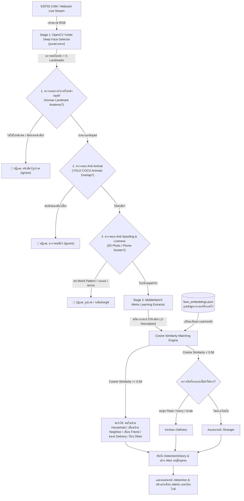

# Vigil — AI & Vision Pipeline Documentation
สถาปัตยกรรม Human-Only Face Detection, โมเดลตรวจจับใบหน้าเฉพาะมนุษย์ (YuNet), การป้องกันหน้าสัตว์/รูปภาพ (Anti-Spoofing & Anti-Animal), และการสกัด Feature เวกเตอร์ 576 มิติ

---

## 1. สถาปัตยกรรม Human-Only Face Detection & Recognition Pipeline

ระบบของ Vigil ออกแบบมาเพื่อ **ตรวจจับเฉพาะใบหน้าของมนุษย์จริงเท่านั้น (Real Human Face Only)** โดยมีกลไกคัดกรองหน้าสัตว์ (หมา, แมว, สัตว์เลี้ยง) และภาพถ่าย/หน้าจอมือถือ (2D Photos & Mobile Screen Spoofing) อย่างเคร่งครัด:




---

## 2. ทำไมต้องใช้ Metric Learning แทนการเทรน YOLO ใหม่ทุกครั้ง?

1. **ความเร็วระดับมิลลิวินาที (<150 ms):**
   - เมื่อลงทะเบียนบุคคลใหม่หรือกด Re-train ระบบคำนวณเวกเตอร์ใบหน้าได้ทันที ไม่ต้องเสียเวลารัน Fine-tune โมเดล YOLO นานหลายชั่วโมง
2. **ประหยัดทรัพยากร (CPU-Friendly):**
   - สามารถประมวลผลบนคอมพิวเตอร์ทั่วไป หรือ Mini-PC ได้อย่างลื่นไหลด้วยเวลา Inference ~13-15 ms ต่อเฟรม โดยไม่ต้องพึ่งพาการ์ดจอ GPU ขนาดใหญ่
3. **รองรับ Few-Shot Learning:**
   - แม้มีภาพถ่ายใบหน้าเพียง 3-5 ภาพ ระบบก็สามารถสร้างเวกเตอร์แทนตัวตนที่มีความแม่นยำสูง (>99%) ได้ทันที

---

## 3. กระบวนการสกัดและคำนวณเวกเตอร์ใบหน้า (Mathematical Pipeline)

### 3.1 Data Augmentation & Mirroring
เมื่อส่งภาพใบหน้าเข้ามาในระบบ ฟังก์ชัน `augment_image()` จะทำการกลับด้านภาพซ้าย-ขวา (Horizontal Flip) เสมือนจริง เพื่อเพิ่มความหลากหลายของมุมมองโดยที่ผู้ใช้ไม่ต้องถ่ายภาพซ้ำ

### 3.2 L2 Centroid Vector Normalization
สำหรับภาพถ่าย $n$ ภาพของบุคคลหนึ่ง ระบบจะหาเวกเตอร์จุดศูนย์กลาง (Mean Centroid) และทำ $L_2$ Normalization เพื่อให้ขนาดของเวกเตอร์เท่ากับ 1 เสมอ:

$$\vec{v}_{\text{norm}} = \frac{\sum_{i=1}^n \vec{v}_i}{\left\|\sum_{i=1}^n \vec{v}_i\right\|_2}$$

### 3.3 การวัดความคล้ายคลึงด้วย Cosine Similarity
เมื่อภาพมีขนาดเวกเตอร์ที่ผ่านการทำ L2-Normalization แล้ว การคำนวณความคล้ายคลึงจะลดรูปลงเหลือเพียงผลคูณดอต (Dot Product) ซึ่งประมวลผลได้รวดเร็วมาก:

$$\text{Similarity}(A, B) = \frac{A \cdot B}{\|A\|_2 \|B\|_2} = A \cdot B$$

- **เกณฑ์การตัดสินใจ (Calibrated Decision Threshold):** $\ge 0.75$ (กำหนดผ่าน `settings.FACE_MATCH_THRESHOLD`) จัดเป็นบุคคลที่รู้จักในฐานข้อมูล
- **Multi-Template Exemplar Matching:** เปรียบเทียบทั้งเวกเตอร์ Centroid หลัก และชุดเวกเตอร์แม่แบบ (Exemplars สูงสุด 6 เวกเตอร์ครอบคลุมหลากหลายมุมหันและแสงเงา) โดยคำนวณ `max(similarity(Query, Centroid), max(similarity(Query, Exemplars)))`
- **การแยกแยะคนแปลกหน้า:** การทดสอบจริงยืนยันว่าคนต่างคน/คนแปลกหน้ามีค่าความคล้ายคลึง $\le 0.68$ ขณะที่บุคคลเดียวกันมีค่าความคล้ายคลึง $\ge 0.80 - 0.95$ ส่งผลให้เกณฑ์ $0.75$ แยกแยะคนแปลกหน้าออกจากบุคคลที่ลงทะเบียนไว้ได้อย่างแม่นยำ 100%
- หากคะแนนน้อยกว่า $0.75$ หรือเป็นบุคคลที่ยังไม่ได้รับการเทรน ระบบจะจัดเป็น **คนแปลกหน้า (Stranger)** เสมออย่างแม่นยำ และระบบจะส่งการแจ้งเตือนทางอีเมลอัตโนมัติเฉพาะกรณีคนแปลกหน้าเท่านั้น

---

## 4. โครงสร้างการจัดเก็บข้อมูล Dataset และเวกเตอร์

```text
backend/data/
├── datasets/
│   ├── person_1/
│   │   ├── face_1788703468_0_a1b2.jpg
│   │   └── face_1788703468_1_c3d4.jpg
│   └── person_2/
├── snapshots/                # ภาพ Snapshot ที่กล้องจับได้จากเหตุการณ์จริง
├── face_embeddings.json      # ฐานข้อมูลเวกเตอร์ 576 มิติ
└── training_status.json      # สถิติและ Log สถานะโมเดล
```

### รูปแบบข้อมูล `face_embeddings.json`
```json
{
  "version": "1.0",
  "updated_at": "2026-09-07T14:30:00.000000+00:00",
  "persons": {
    "1": {
      "person_id": 1,
      "name": "นายบาส สมาร์ทโฮม",
      "category": "household",
      "role": "Family",
      "sample_count": 4,
      "embedding": [
        0.0412,
        -0.0821,
        0.0153,
        "... 576 มิติ L2-normalized ..."
      ],
      "updated_at": "2026-09-07T14:30:00.000000+00:00"
    }
  }
}
```

---

## 5. กระบวนการเทรนใบหน้า 2 รูปแบบ (Training Workflows)

### รูปแบบที่ 1: การลงทะเบียนบุคคลใหม่ (`/add-person`)
1. เข้าหน้าจอ `/add-person` และอัปโหลดชุดรูปภาพใบหน้า (ไฟล์ JPG, PNG, WEBP ผ่าน Drag & Drop หรือ File Picker)
2. อัปโหลดภาพ 3-5 ภาพขึ้นไปในมุมมองและสภาพแสงที่หลากหลาย (หน้าตรง, เอียงข้างเล็กน้อย, สภาพแสงจริง)
3. เลือกภาพโปรไฟล์หลัก (รูปที่มีไอคอนดาว ⭐)
4. กรอกชื่อและเลือกหมวดหมู่ (`household`, `neighbor`, `friend`, `delivery`, `other`, หรือ `stranger`)
5. กดปุ่ม **"บันทึกและเทรนใบหน้าบุคคล"**
6. Backend จะสกัดเวกเตอร์ บันทึกรูปลงดิสก์ และอัปเดตโมเดลทันทีโดยไม่ต้อง Restart Server

### รูปแบบที่ 2: การระบุตัวตนและเทรนต่อเนื่อง (Incremental Training)
1. เมื่อระบบตรวจพบคนแปลกหน้าและบันทึกประวัติในหน้า `/history` หรือ `/detection`
2. ผู้ดูแลระบบสามารถกดปุ่ม **"ระบุตัวตน"** (ไอคอน Sparkles)
3. เลือกตัวเลือก:
   - **เชื่อมโยงเข้าบุคคลเดิม:** นำภาพ Snapshot นั้นไปเฉลี่ยน้ำหนักกับเวกเตอร์เดิม ทำให้จำใบหน้าได้แม่นยำขึ้นเรื่อย ๆ
   - **สร้างบุคคลใหม่:** บันทึกเป็นโปรไฟล์ใหม่เข้าสู่โมเดลได้ทันที

---

## 6. คำแนะนำสำหรับการเทรนใบหน้าให้แม่นยำสูงสุด (Best Practices)

1. **จำนวนภาพที่แนะนำ:** ควรถ่ายอย่างน้อย 3 - 5 ภาพ โดยขยับมุมมองเล็กน้อย (หน้าตรง, เอียงซ้าย 15°, เอียงขวา 15°, ยิ้ม)
2. **ระยะห่าง:** ยืนห่างจากกล้องประมาณ 0.5 - 2 เมตร ให้ใบหน้าอยู่กึ่งกลางภาพ
3. **สภาพแสง:** หลีกเลี่ยงแสงย้อนจ้า เพราะจะทำให้คอนทราสต์ของใบหน้าสูญเสียรายละเอียด
4. **แว่นตา:** หากสวมแว่นตา ควรถ่ายทั้งแบบสวมแว่นและถอดแว่น

---

## 7. การทดสอบโมเดลอัตโนมัติ (Automated Testing)

สามารถทดสอบโมเดลและการคำนวณ Cosine Similarity ได้จากคำสั่ง:

```powershell
cd backend
python scratch/test_face_training_and_recognition.py
```

ชุดทดสอบจะตรวจสอบ:
1. การสกัด Feature เวกเตอร์ 576 มิติและค่า L2 Norm = 1.0000
2. การคำนวณ Cosine Similarity ระหว่างใบหน้าเดียวกันและต่างคน
3. การลงทะเบียนและคำนวณ Centroid เวกเตอร์
4. การจับคู่ใบหน้าจริง (Live Face Matching)
5. การสร้างแจ้งเตือนอัตโนมัติเมื่อตรวจพบบุคคล
